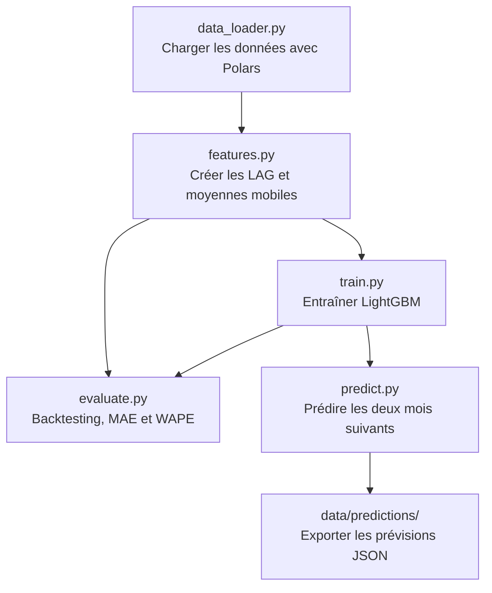

# AverageForecasting — Architecture du projet

## Structure du projet

```text
forecasting/
├── data/
│   ├── raw/                     # Données originales
│   ├── processed/               # Données préparées
│   └── predictions/             # Prévisions exportées en JSON
├── models/                      # Modèles LightGBM sauvegardés
├── notebooks/
│   ├── exploration.ipynb        # Exploration et visualisation des prix
│   └── training.ipynb           # Expérimentation et entraînement
├── __init__.py
├── __main__.py                  # uv run python -m forecasting
├── config.py                    # Chemins et paramètres
├── data_loader.py               # Chargement Polars
├── features.py                  # Lags et moyennes mobiles
├── train.py                     # Entraînement et sauvegarde
├── evaluate.py                  # Holdout chronologique, MAE et WAPE
├── predict.py                   # Prévision récursive de deux mois
└── main.py                      # uv run forecast depuis la racine
```

Les dépendances, le lockfile et l'environnement `.venv` sont gérés à la racine
avec le composant agent. Les tests sont dans `tests/test_forecasting.py` à la
racine : `uv run python -m unittest discover -s tests -v`.

## Diagramme du fonctionnement


